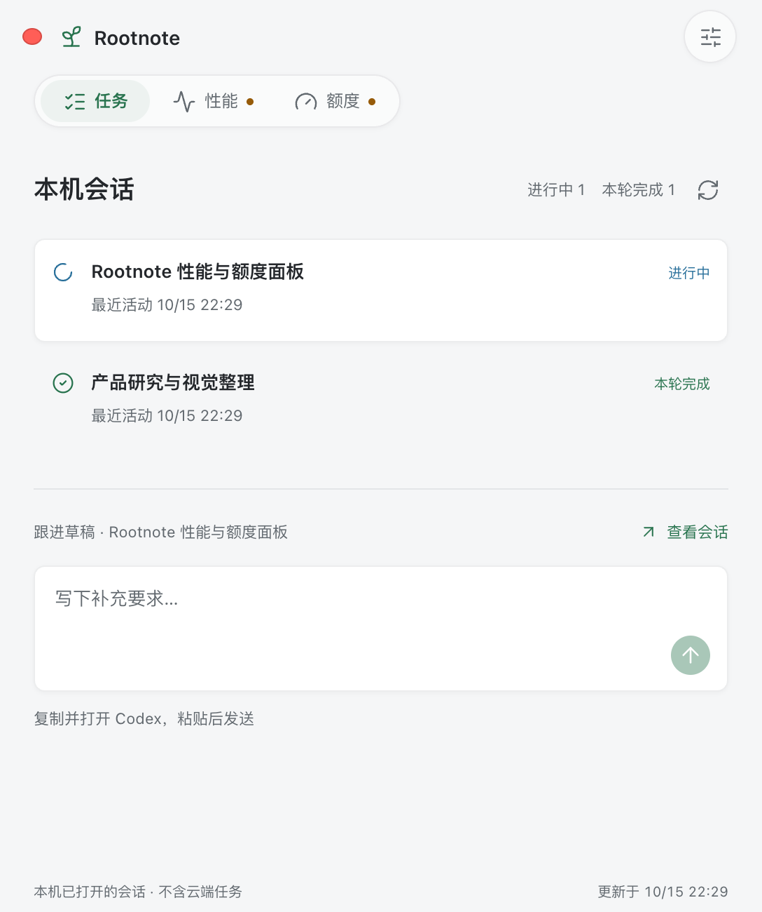
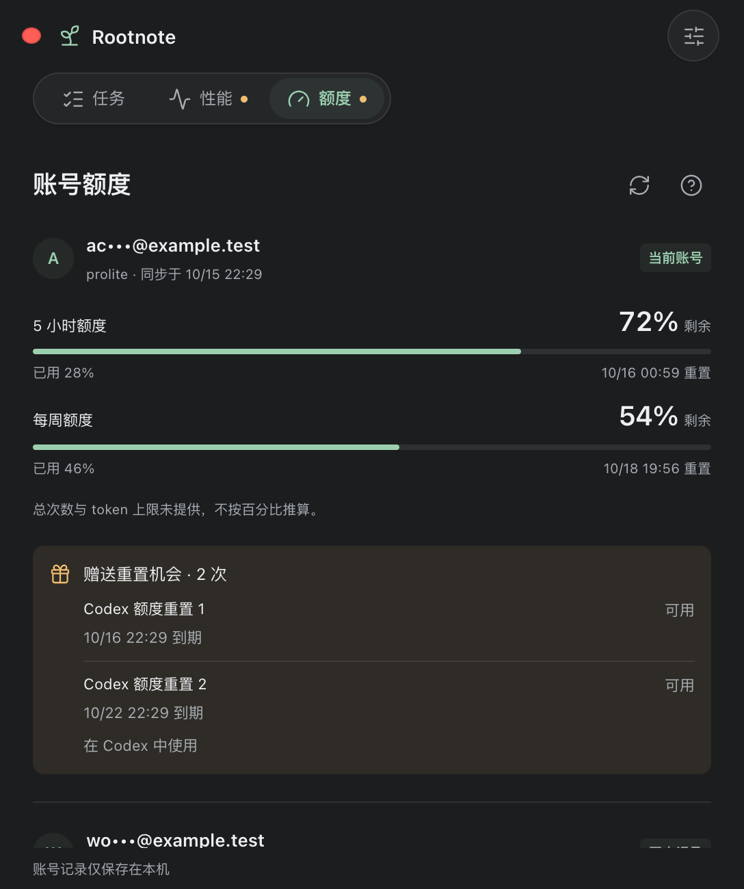
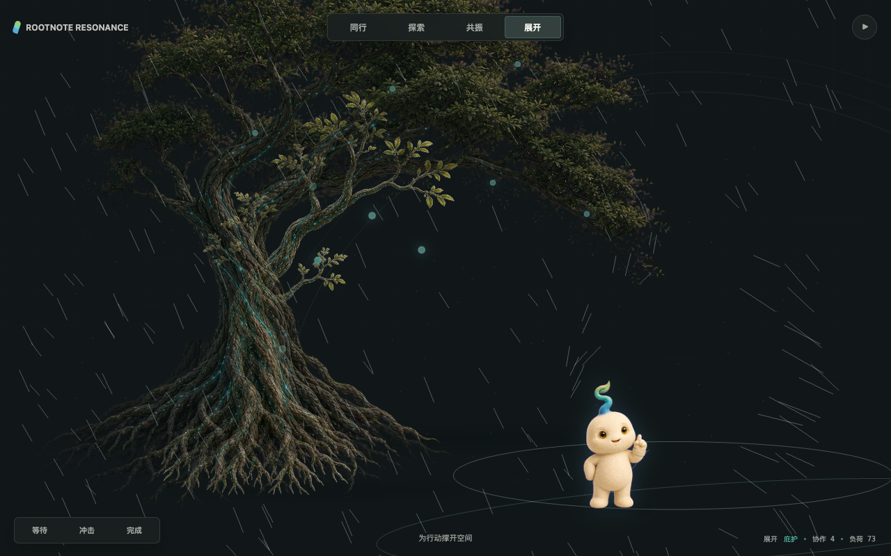

<p align="center"></p>

# Rootnote

**陪你使用 Codex，也帮你看清任务、性能和额度。**

Rootnote 是一个面向 macOS 的本地桌面伴侣：用宠物与环境场景呈现工作状态，把本机会话、资源压力和账号额度放在一个轻量面板里。在需要关注时给出建议，是否归档、何时继续，仍由你决定。

[开始使用](#开始使用) · [安装说明](docs/INSTALL.md) · [隐私与边界](docs/PRIVACY.md) · [参与贡献](CONTRIBUTING.md) · [English](docs/README.en.md)

## 看一眼

<p></p>

面板预览使用合成演示数据，不包含真实账号或会话；截图展示网页内容层，macOS 原生玻璃以应用运行效果为准。



独立场景预览。实际桌面模式由 Codex 显示宠物，Rootnote 提供环境与性能提示，不重复绘制宠物。

## 能做什么

| 功能 | 体验 |
| --- | --- |
| 桌面宠物与场景 | 提供 Rootnote 宠物素材、活动状态动画和可选桌面环境；宠物由兼容的 Codex 客户端显示 |
| 本机会话 | 查看当前检测到的会话及状态，选择任务继续跟进 |
| 性能守卫 | 查看内存、交换内存、压缩内存和会话文件体积；异常时显示建议 |
| 账号额度 | 同步接口实际提供的额度周期、剩余/已用比例、重置时间和赠送重置机会 |
| 跟进输入 | 支持划选、剪切、复制、粘贴；点击箭头复制内容并打开对应会话 |
| 原生外观 | 浅色与深色；macOS 26 上的自有导航和按钮使用系统 Liquid Glass |

## 为什么做它

使用 Codex 做长任务时，工作分散在会话、任务状态、系统资源和额度页面之间。
Rootnote 不再增加一个需要管理的工作台，而是给这些信息一个靠近桌面的入口：
现在有什么任务，需要关注什么，下一步可以怎么处理。

宠物提供陪伴感，守卫提供可行动的信息。提醒不等于代替用户执行。

## 开始使用

当前是 **0.10.6 源码预览版**，适合愿意自行构建的 macOS 用户。尚未提供经过 Developer ID 签名与 Apple 公证的下载应用；不要把自行构建的临时签名包当成已公证版本。

需要 macOS、包含 macOS 26 SDK 的 Xcode/命令行工具、Node.js 22.12+ 和 pnpm 10.19+。
桌面宠物及额度集成还需要兼容并已登录的 Codex / ChatGPT 桌面客户端。

```sh
git clone https://github.com/icvarts/rootnote.git
cd rootnote
npm ci
npm test
npm run build
zsh scripts/install.sh
```

在 Finder 中打开 `~/Applications/Rootnote Resonance.app`。构建和安装不会自动启动应用、添加登录项或替换 Codex。若已安装 Rootnote，安装脚本会停止，不覆盖现有版本。

宠物素材按需安装：

```sh
zsh scripts/install-pet.sh
```

然后在支持自定义宠物的客户端中手动选择 Rootnote。客户端版本不支持时，菜单栏面板仍是 Rootnote 的独立入口。完整安装、权限、更新与卸载说明见 [安装指南](docs/INSTALL.md)。

## 提醒怎样判断

- 会话体积达到 250 MB：建议整理进展，关注后续增长。
- 达到 500 MB：已完成的会话建议归档；仍在运行时先等待本轮结束。
- 达到 1 GB：建议优先处理；运行状态和采集可信度仍优先于阈值。
- 数据不可用时显示未知或采集异常，不把缺失数据当作正常。

这些是本地经验阈值，不是 OpenAI 的官方限额。**会话文件大小不等于上下文长度或 token 用量，也不能证明它是内存压力的原因。** Rootnote 不会自动归档、清缓存、杀进程或消费重置机会。

## 重要边界

- 不是 Apple 或 OpenAI 官方产品；不包含或修改它们的客户端。
- 显示的是本机可检测到的会话，不承诺覆盖云端任务。
- 输入箭头目前是“复制并打开”，需要在 Codex 中粘贴发送，不是直接发送。
- 宠物的消息、语音、通知控件由 Codex 提供，不属于本仓库可重新实现或定制的功能。
- 不接管审批，不提供无共享通道的“允许一次”按钮。
- 额度依赖客户端接口；未返回的次数、token 总量、订阅到期日期不会推算补齐。
- macOS 14/15 使用材质回退；这些系统及 Intel 设备尚未实机验证。原生液态玻璃需要 macOS 26。

## 数据留在什么地方

Rootnote 在本机解析系统和 Codex 状态，不设置自己的云端服务或统计上报。
活动场景会在内存中解析会话事件，包括部分工具调用字段；因此不声称“完全不读取内容”。
应用不保存完整对话副本。脱敏账号额度和偏好保存在本机；同步额度时调用 Codex CLI，后者可能连接 OpenAI。
详见 [数据清单与隐私说明](docs/PRIVACY.md)。

## 开发与验证

```sh
npm test
npx playwright install chromium
pnpm --dir scene install --frozen-lockfile
npm run test:browser
npm run test:scene
npm run test:native
```

浏览器测试只证明网页内容层的布局和交互，不证明原生玻璃的合成效果。
源码结构、构建依赖和验证范围见 [开发指南](docs/DEVELOPMENT.md)。

## 许可

代码及文档采用 [MIT](LICENSE)。宠物与场景图片适用 [素材说明](ASSETS.md)；第三方组件见 [许可清单](THIRD_PARTY_NOTICES.md)。
欢迎提交兼容性反馈、问题复现与改进，不要在 Issue 中附带账号凭据或真实对话日志。
