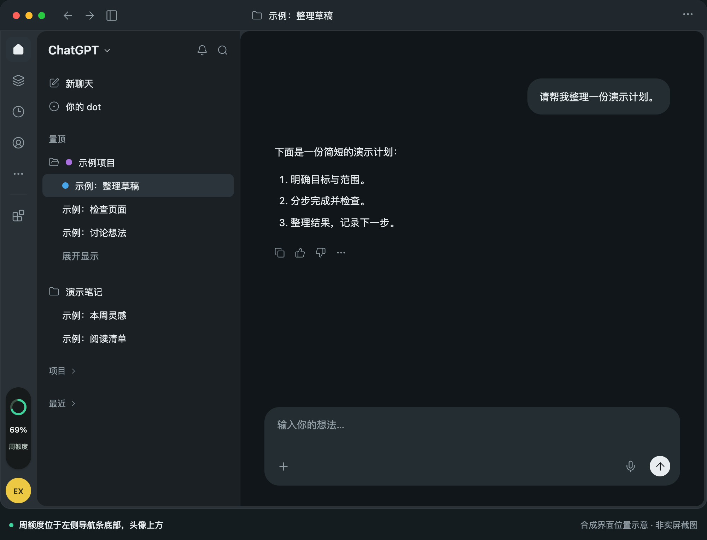
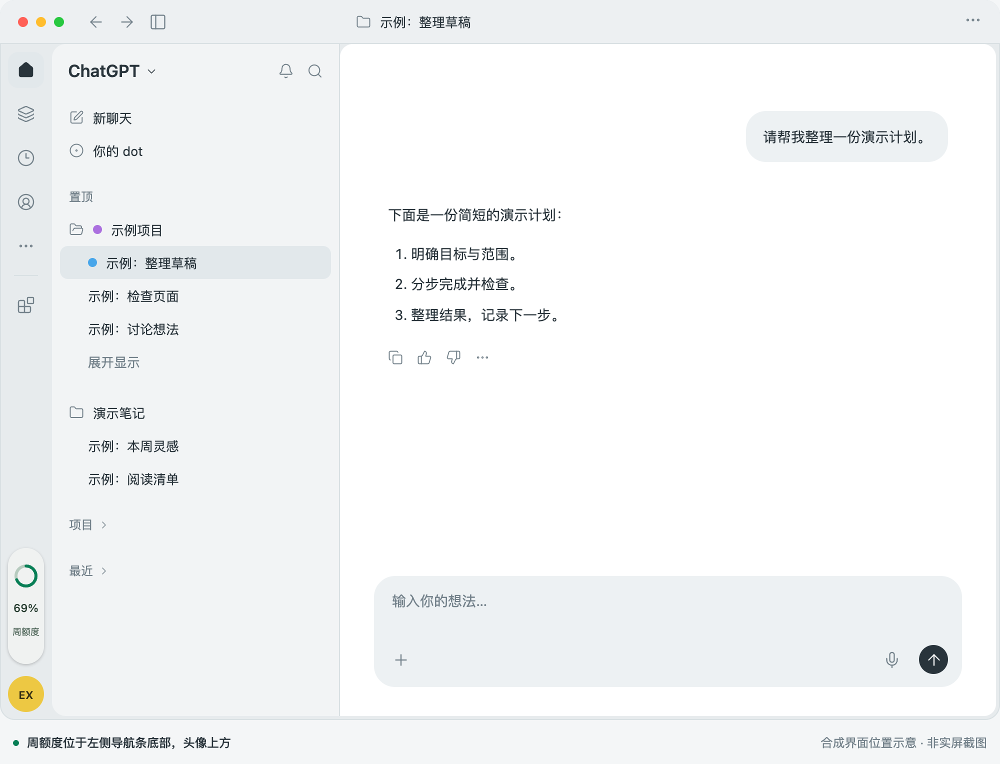

# Rootnote

A local-first macOS companion for Codex, combining a desktop character, task visibility, resource warnings and account usage limits.

Rootnote provides editable native and web source, a Three.js environment, character assets and regression tests.
The character itself is rendered by a compatible Codex client; its native voice, messaging and notification controls are not part of this repository.

## Source preview

Version [0.10.12](https://github.com/icvarts/rootnote/releases/tag/v0.10.12) is a source preview. The Release provides source archives only, without an app installer or a notarized consumer download.
Building requires a macOS 26 SDK, Node.js 22.12+ and pnpm 10.19+.
The deployment target is macOS 14, but older systems and Intel hardware are not yet validated.
Native Liquid Glass is used on macOS 26, with material fallbacks on older systems.

```sh
git clone https://github.com/icvarts/rootnote.git
cd rootnote
npm ci
npm test
npm run build
zsh scripts/install.sh
```

The installer refuses to overwrite an existing app. It does not launch the app, add login items or modify Codex.
Optional character installation: `zsh scripts/install-pet.sh`.

## Sidebar weekly quota

An independent Rootnote overlay attaches to the navigation rail of compatible desktop clients. It needs macOS Accessibility permission and a visible, recognizable sidebar. Clicking it toggles the existing quota page; it shares one panel with the performance entry and does not show or hide the pet.



<details>
<summary>View the light appearance in context</summary>



</details>

The capsule sits at the bottom of the far-left navigation rail, centered above the account avatar. The 52 pt rail, 36×116 pt capsule surface and 12 pt gap follow the implementation. The capsule uses the actual web component; the surrounding client layout, projects, conversations, account and 69% quota are synthetic. These are location illustrations, not desktop captures.

The capsule follows the host window and appearance independently of the Rootnote panel theme. Only its visual background is 95% opaque; the input layer is invisible and outer regions pass clicks through. Reduce Transparency uses an opaque background. Unknown geometry, occlusion or unsupported appearance formats hide the overlay instead of guessing a position.

Host sidebar structure and theme fields are compatibility details, not stable public APIs. Rootnote does not patch the client or recolor its native pet controls. See the Chinese [sidebar guide](侧栏额度.md).

## Boundaries

- Session file size is not token usage or context length.
- Warnings do not automatically archive tasks, kill processes or clear caches.
- The follow-up arrow copies text and opens a conversation; it does not send it.
- Account fields are shown only when returned by the client interface.
- Activity classification parses local event fields in memory, including some tool inputs/outputs. Full conversation copies are not persisted.
- No Rootnote cloud telemetry; Codex CLI may contact OpenAI for account limits.
- Independent community software, not an official Apple or OpenAI product.

Code and documentation: [MIT](../LICENSE). Character/image permissions: [asset notice](../ASSETS.md).
See the Chinese [installation](INSTALL.md), [privacy](PRIVACY.md) and [development](DEVELOPMENT.md) guides.
